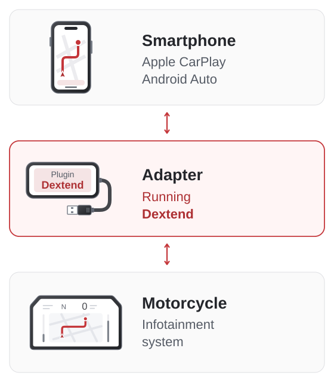

      

**Apple CarPlay and Android Auto on your motorcycle display** - with the Dextend plugin installed on an external adapter.

Dextend is a single plugin designed for different motorcycles and adapters. Check the list for your motorcycle’s make, model, model year and compatibility status.

[Project status](#stan-projektu) · [Motorcycle compatibility](#wybierz-motocykl) · [Adapters](#posredniki) · [How it works](#jak-to-dziala) · [Before installation](#przed-instalacja) · [License and project independence](#warunki-wykorzystania) · [Support the project](#wsparcie)

## 📦 Project status

[Current version](VERSION)

- Apple CarPlay and Android Auto integration with the motorcycle display.
- Verified support for the 2023-2024 Yamaha TRACER 9 GT+.
- Plugin installation and operation on the Carlinkit CPC200-CCPA / A15W adapter.

## 🏍️ Motorcycle compatibility

| Make | Model | Model years | Compatibility&nbsp;status | Adapter |
| --- | --- | --- | --- | --- |
| Yamaha | TRACER 9 GT+ | 2023-2024 |  | [CPC200-CCPA / A15W](#posrednik-ccpa) |
| Yamaha | NIKEN GT | 2023 |  | [CPC200-CCPA / A15W](#posrednik-ccpa)¹ |
| Yamaha | TMAX / TMAX Tech MAX | 2022-2024 |  | [CPC200-CCPA / A15W](#posrednik-ccpa)¹ |
| Yamaha | TMAX / TMAX Tech MAX | 2025 |  | [CPC200-CCPA / A15W](#posrednik-ccpa)¹ |
| Yamaha | TRACER 9 GT | 2025+ |  | [CPC200-CCPA / A15W](#posrednik-ccpa)¹ |
| Yamaha | TRACER 9 GT+ | 2025+ |  | [CPC200-CCPA / A15W](#posrednik-ccpa)¹ |
| Yamaha | MT-09 | 2025+ |  | Undetermined |

| Compatibility&nbsp;status | Meaning |
| --- | --- |
|  | Dextend has been verified on the motorcycle. |
|  | Dextend is likely to be compatible. Motorcycle testing is still pending. |
|  | Support for this model is planned. Compatibility testing and adapter selection are still pending. |

¹ This adapter still needs to be tested with the listed motorcycle model. The label `2025+` refers to the generation introduced for model year 2025. Later model years still need their own compatibility checks.

We tested Apple CarPlay and Android Auto on our 2024 Yamaha TRACER 9 GT+. Both worked on that motorcycle. The beta may still have bugs.

## 🔌 Adapters for installing the plugin

The compatibility table lists the adapter for your motorcycle and its support status.

| Manufacturer | Model | Revision | Firmware |
| --- | --- | --- | --- |
| Carlinkit | CPC200-CCPA / A15W | `YMA0-WN16-0003` | `2026.07.31.1733` |
| Carlinkit | CPC200-CCPA / A15W | `YMA0-WN16-0003` | `2025.10.15.1127` |
| Carlinkit | CPC200-CCPA / A15W | `YMA0-WN16-0003` | `2025.02.25.1521` (USB installation verified with Dextend 1.2-beta) |

CPC200-CCPA / A15W is the name of a device family. On the adapter’s **Box Info** screen, check **Hardware Version** for the hardware revision and **Version** for the firmware. The table lists the manufacturer’s firmware versions on which we tested Dextend.

Dextend is designed for the adapters listed in the table. Installation and updates may vary by hardware revision and firmware version, even within the same model.

Unlisted revisions or firmware versions may still work with Dextend. We have yet to confirm how installation works on those device variants.

## 🔗 How it works

An adapter running Dextend connects Apple CarPlay or Android Auto on your phone to the motorcycle’s infotainment system.

## 🔧 Before installation

1. Find your motorcycle’s make, model and model year in the list. Check the compatibility status and any exclusions.
2. Click the adapter listed for your motorcycle. Compare its manufacturer, model, hardware revision and firmware with the table.

Download the [A15W_Update.img installation image](https://github.com/jacob-overev/dextend-plugin/releases/latest/download/A15W_Update.img) and its [SHA256SUMS checksum file](https://github.com/jacob-overev/dextend-plugin/releases/latest/download/SHA256SUMS).

[USB installation (PDF)](docs/installation-en.pdf) · [Connection and operation (PDF)](docs/operation-en.pdf) · [Collect diagnostic logs (PDF)](docs/diagnostics-en.pdf)

Markdown: [Installation](docs/installation.md) · [Operation](docs/operation.md) · [Diagnostics](docs/diagnostics.md)

## 📜 License and project independence

I release the independently developed part of the plugin under the **[PolyForm Noncommercial License 1.0.0](https://polyformproject.org/licenses/noncommercial/1.0.0)**. The original license terms apply, with no added restrictions.

Dextend is an independent project by Overev. It has no affiliation with, endorsement from, or support from the companies behind the listed devices and integrations. Product names and trademarks belong to their respective owners and are used to describe compatibility.

## ☕ Support the author

Dextend is a hobby project I work on in my spare time.

If you use the plugin or just like what I’m doing, you can support my work. Contributions help cover the cost of developing Dextend. Thanks for your support!

Support is voluntary. The plugin is available free of charge under its license. Contributions do not pay for installation or technical support.

 

## Development

[Build instructions and host tests](docs/development/README.md)
