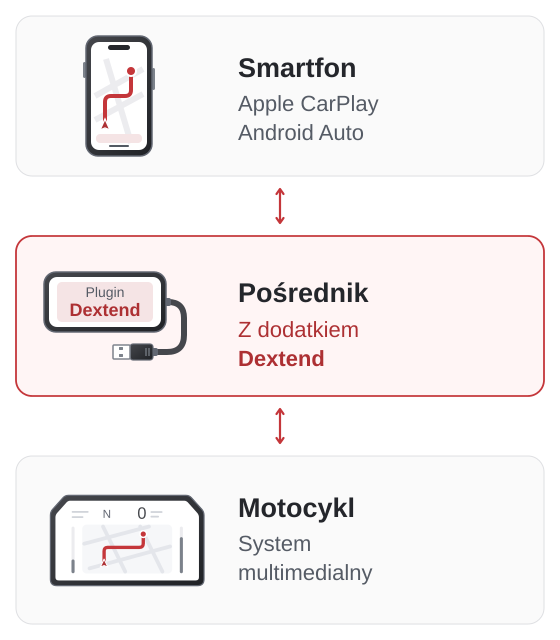

      

**Apple CarPlay i Android Auto na ekranie motocykla** - dzięki dodatkowi Dextend instalowanemu na zewnętrznym urządzeniu pośredniczącym.

To jeden dodatek rozwijany dla różnych motocykli i pośredników. Sprawdź na liście markę, model i rocznik swojego motocykla oraz status zgodności.

[Stan projektu](#stan-projektu) · [Zgodność motocykli](#wybierz-motocykl) · [Pośredniki](#posredniki) · [Jak to działa](#jak-to-dziala) · [Przed instalacją](#przed-instalacja) · [Licencja i niezależność projektu](#warunki-wykorzystania) · [Wesprzyj projekt](#wsparcie)

## 📦 Stan projektu

[Aktualna wersja](VERSION)

- Integracja Apple CarPlay i Android Auto z ekranem motocykla.
- Potwierdzona obsługa Yamaha TRACER 9 GT+ z roczników 2023-2024.
- Instalacja i działanie dodatku na pośredniku Carlinkit CPC200-CCPA / A15W.

## 🏍️ Zgodność motocykli

| Marka | Model | Roczniki | Status&nbsp;zgodności | Pośrednik |
| --- | --- | --- | --- | --- |
| Yamaha | TRACER 9 GT+ | 2023-2024 |  | [CPC200-CCPA / A15W](#posrednik-ccpa) |
| Yamaha | NIKEN GT | 2023 |  | [CPC200-CCPA / A15W](#posrednik-ccpa)¹ |
| Yamaha | TMAX / TMAX Tech MAX | 2022-2024 |  | [CPC200-CCPA / A15W](#posrednik-ccpa)¹ |
| Yamaha | TMAX / TMAX Tech MAX | 2025 |  | [CPC200-CCPA / A15W](#posrednik-ccpa)¹ |
| Yamaha | TRACER 9 GT | 2025+ |  | [CPC200-CCPA / A15W](#posrednik-ccpa)¹ |
| Yamaha | TRACER 9 GT+ | 2025+ |  | [CPC200-CCPA / A15W](#posrednik-ccpa)¹ |
| Yamaha | MT-09 | 2025+ |  | Nieustalony |

| Status&nbsp;zgodności | Znaczenie |
| --- | --- |
|  | Działanie Dextend potwierdzono na motocyklu. |
|  | Zgodność z Dextend jest prawdopodobna, ale nie została jeszcze potwierdzona w testach na motocyklu. |
|  | Model jest w planach. Obsługa nie została jeszcze potwierdzona, a pośrednik nie został wybrany. |

¹ Ten pośrednik wymaga jeszcze sprawdzenia z danym modelem motocykla. Oznaczenie `2025+` odnosi się do generacji od rocznika 2025 i nie potwierdza zgodności wszystkich późniejszych roczników.

Apple CarPlay i Android Auto sprawdziliśmy na naszej Yamasze TRACER 9 GT+ z 2024 roku. Oba działały na tym motocyklu. W becie mogą jeszcze występować błędy.

## 🔌 Urządzenia pośredniczące do instalacji dodatku

Pośrednik dla Twojego motocykla jest wskazany w tabeli zgodności, razem ze statusem jego obsługi.

| Producent | Model | Rewizja | Firmware |
| --- | --- | --- | --- |
| Carlinkit | CPC200-CCPA / A15W | `YMA0-WN16-0003` | `2026.07.31.1733` |
| Carlinkit | CPC200-CCPA / A15W | `YMA0-WN16-0003` | `2025.10.15.1127` |
| Carlinkit | CPC200-CCPA / A15W | `YMA0-WN16-0003` | `2025.02.25.1521` (Instalacja USB potwierdzona z Dextend 1.2-beta) |

CPC200-CCPA / A15W to oznaczenie rodziny urządzeń. Rewizję sprzętu sprawdzisz w polu **Hardware Version**, a firmware w polu **Version** na ekranie **Box Info** pośrednika. Tabela zawiera wersje firmware producenta, na których przetestowaliśmy Dextend.

Dextend jest przeznaczony dla modeli pośredników wymienionych w tabeli. Nawet w obrębie jednego modelu instalacja i aktualizacja mogą przebiegać inaczej, zależnie od rewizji sprzętu i wersji firmware.

Jeśli Twojej rewizji lub wersji firmware nie ma na liście, nie wyklucza to zgodności z Dextend. Oznacza jedynie, że nie mamy jeszcze informacji o instalacji na takim wariancie urządzenia.

## 🔗 Jak to działa

Pośrednik z zainstalowanym Dextend łączy Apple CarPlay lub Android Auto na smartfonie z systemem multimedialnym motocykla.

## 🔧 Przed instalacją

1. Znajdź na liście markę, model i rocznik swojego motocykla. Sprawdź status zgodności i ewentualne wykluczenia.
2. Kliknij nazwę pośrednika przy swoim motocyklu. Porównaj producenta i model urządzenia oraz jego rewizję i firmware z danymi w tabeli.

Pobierz [obraz instalacyjny A15W_Update.img](https://github.com/jacob-overev/dextend-plugin/releases/latest/download/A15W_Update.img) i [plik kontrolny SHA256SUMS](https://github.com/jacob-overev/dextend-plugin/releases/latest/download/SHA256SUMS).

[Instalacja z pendrive’a (PDF)](docs/installation-pl.pdf) · [Połączenie i obsługa (PDF)](docs/operation-pl.pdf) · [Zbieranie logów diagnostycznych (PDF)](docs/diagnostics-pl.pdf)

Markdown: [Instalacja](docs/installation.pl.md) · [Obsługa](docs/operation.pl.md) · [Diagnostyka](docs/diagnostics.pl.md)

## 📜 Licencja i niezależność projektu

Własną, niezależną część dodatku udostępniam na **[PolyForm Noncommercial License 1.0.0](https://polyformproject.org/licenses/noncommercial/1.0.0)**. Obowiązuje oryginalny tekst licencji, bez dodatkowych ograniczeń.

Dextend jest niezależnym projektem Overev. Nie jest powiązany z producentami wymienionych urządzeń i integracji ani przez nich zatwierdzony lub wspierany. Nazwy produktów i znaki towarowe należą do ich właścicieli i służą opisowi zgodności.

## ☕ Wesprzyj autora

Dextend jest projektem hobbystycznym, który tworzę w wolnym czasie.

Jeśli korzystasz z dodatku lub po prostu podoba Ci się to, co robię, możesz wesprzeć moją pracę. Wpłaty pomagają pokrywać koszty dalszego rozwoju Dextend. Dzięki za wsparcie!

Wsparcie jest dobrowolne. Dodatek pozostaje dostępny bezpłatnie na warunkach licencji, a wpłata nie jest opłatą za instalację ani pomoc techniczną.

 

## Rozwój dodatku

[Instrukcja budowy i testy hosta](docs/development/README.pl.md)
